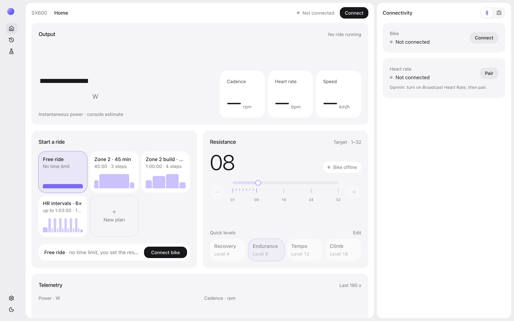
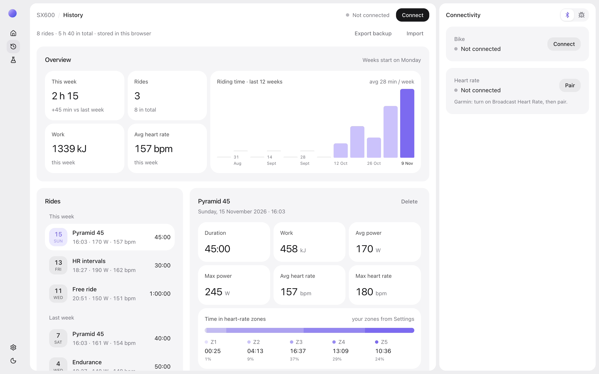
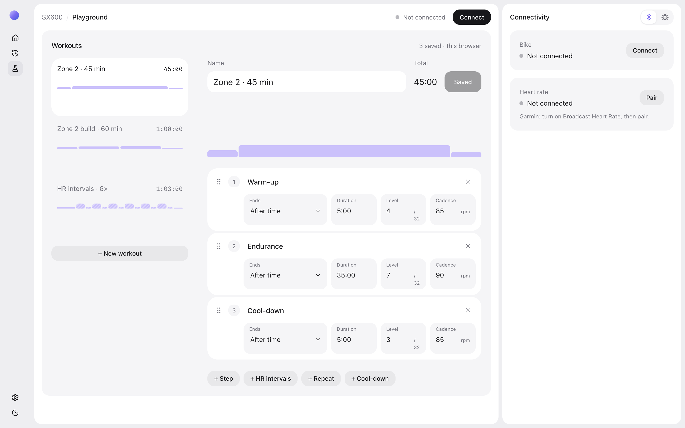
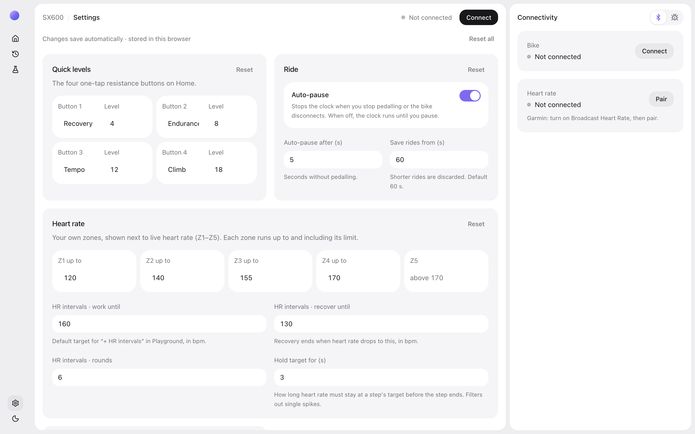
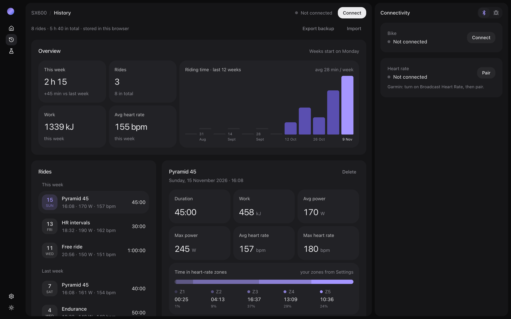
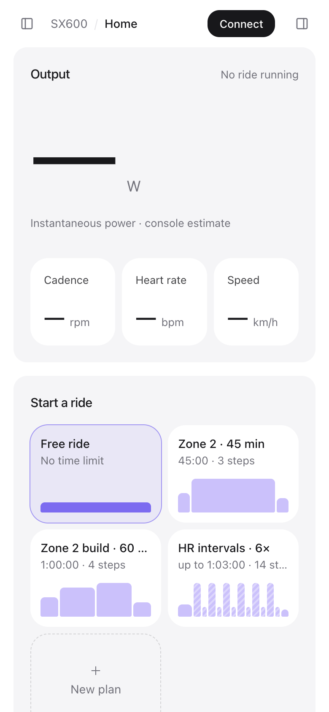

# SX600 Dashboard

A small web dashboard for the **Sportstech SX600** spinning bike. It talks to the bike directly
from the browser using Web Bluetooth. It does not need QZ, a native app, or a backend.



The app can:

- Show live power, cadence, heart rate and speed, plus heart rate from a separate Bluetooth HR
  strap or watch (e.g. Garmin "Broadcast Heart Rate"), which takes priority over the hand grips
- Control resistance (levels 1–32)
- Chart power and cadence over the last 3 minutes, and keep running ride totals
- Build workout plans in the Playground (steps that end after a time or when heart rate reaches a
  target, resistance level, optional cadence cue, repeats, drag to reorder) and ride them with
  automatic resistance changes
- Save rides (1 Hz samples) and browse them in History: weekly totals, per-ride charts and time in
  heart-rate zones. Data stays in this browser (IndexedDB)
- Settings for quick-level buttons, heart-rate zones, interval targets, auto-pause and theme
- A debug console with a log of every Bluetooth packet, for protocol work
- Checkpoint the running ride every 30 s (recovered as "Unfinished" after a crash), auto-pause when
  you stop pedalling, keep the screen awake, and reconnect automatically after a Bluetooth dropout
- Export / import a JSON backup

## Screenshots

| History | Playground |
| --- | --- |
|  |  |
| **Settings** | **Dark mode** |
|  |  |

<p align="center"></p>

The rides in these screenshots are generated demo data; the bike is not connected.

Stack: Next.js 16 (App Router), TypeScript, Tailwind v4, shadcn/ui (Base UI), Recharts, Bun.

## Run

```bash
bun install
bun dev        # http://localhost:3000
bun test       # unit tests (protocol, timing, workouts, history, settings)
bun run lint
bun run typecheck
```

### Browser support

Web Bluetooth works in Chrome and Edge on macOS, Windows, Android and ChromeOS. It is not
available in Safari or Firefox. It needs a secure context: `localhost` or HTTPS.

## Layout

```
src/lib/sx600/
  ftms-control.ts FTMS control point (0x2AD9): request control, start/pause/stop, target resistance/power
  ftms.ts        FTMS Indoor Bike Data parser (service 0x1826, char 0x2AD2): live data
  fitshow.ts     FitShow frames (service 0xFFF0, write 0xFFF2, notify 0xFFF1): init, keep-alive, resistance
  bike.ts        Web Bluetooth connection: discovery (name prefix "ZV-"), notifications, serialised writes
  sx600.test.ts  checksum and parser tests
  write-queue.ts GATT write serialisation: latest-wins resistance, polls dropped when busy
src/lib/heart-rate.ts        standard BLE Heart Rate sensor (0x180D / 0x2A37), with auto-reconnect
src/lib/ride-engine.ts       connection, live data, wall-clock ride timing, auto-pause, workout player,
                             checkpoints, wake lock, auto-reconnect (framework-free)
src/lib/ride.ts              pure timing / downsampling helpers (tested)
src/lib/workouts.ts          workout model + step timing (tested)
src/lib/store.ts             IndexedDB persistence, validated all-or-nothing backup import/export
src/lib/history.ts           weekly totals, grouping, time in HR zones (tested)
src/lib/settings.ts          user settings in localStorage, normalised and validated (tested)
src/lib/debug-log.ts         ring buffer of Bluetooth traffic for the debug console
src/components/bike-provider.tsx  engine in React context; useBikeState() ~1 Hz, useLive() per packet
src/components/app-shell.tsx nav sidebar, top bar and right panel (drawers on phones)
src/components/dashboard.tsx Home: live output, plan picker, resistance, telemetry
src/components/kit.tsx       shared UI: Label, Section, StatGrid, Btn, IconBtn, ConfirmBtn, NumberField
src/app/page.tsx             Home
src/app/workouts/page.tsx    Playground (workout builder)
src/app/history/page.tsx     Saved rides and weekly overview
src/app/settings/page.tsx    Settings
src/app/debug/page.tsx       Full Bluetooth log
```

## Protocol notes

Current SX600 consoles (advertising as `ZV-xxxxxx`) are standard FTMS bikes: QZ handles them in
`ftmsbike.cpp`, and so does this app, through the FTMS control point. The FitShow frames below are
only used as a fallback for older consoles without a control point.

The protocol is ported from [QZ / qdomyos-zwift](https://github.com/cagnulein/qdomyos-zwift),
`src/devices/fitplusbike/fitplusbike.cpp` (the `sportstech_sx600` branches). Line references are
in the source comments.

- Live data comes from the standard FTMS characteristic. Resistance is scaled ÷10, as QZ does
  for this bike.
- Resistance and setup use the proprietary FitShow frames:
  - Frame layout: `02 … <xor> 03`
  - All 32 resistance frames have valid XOR checksums (see the tests).
- Not yet verified on real hardware:
  - Whether the 200 ms keep-alive poll is required.
  - Whether the FTMS resistance scaling is right.
- The power value is estimated by the console, not measured.

## Licence

GPL-3.0-only. See [LICENSE](LICENSE).

The Bluetooth protocol code is derived from [QZ / qdomyos-zwift](https://github.com/cagnulein/qdomyos-zwift),
which is licensed under GPL-3.0, so this project is released under the same licence.
